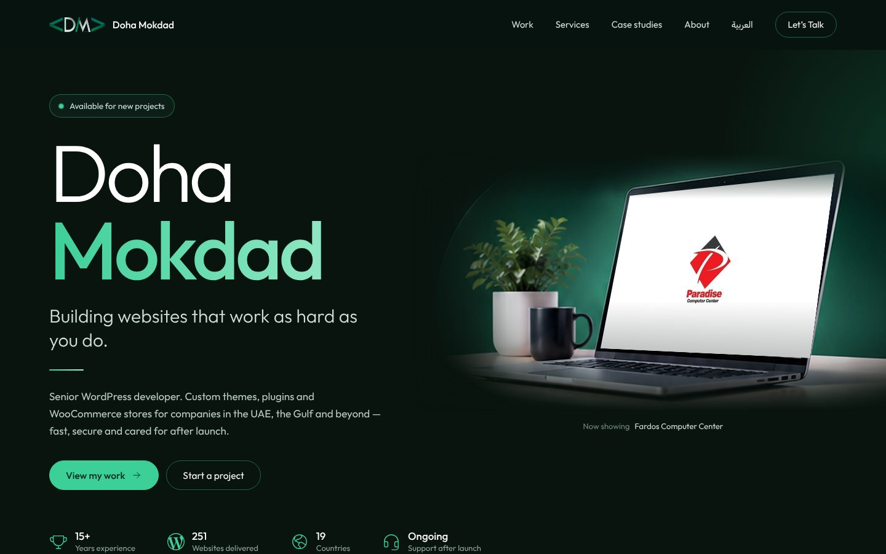
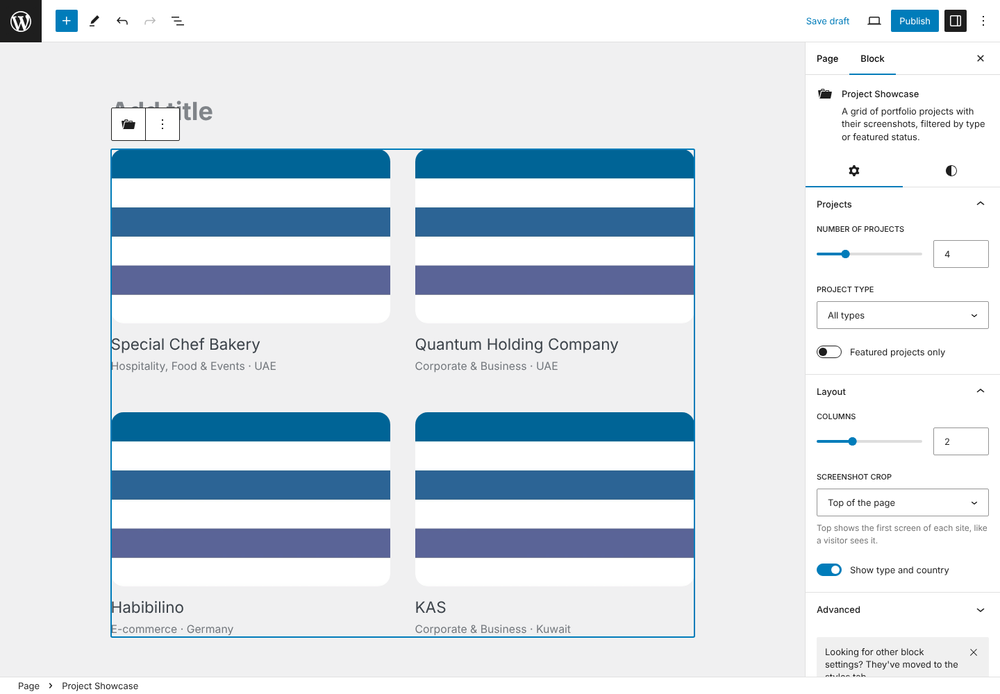
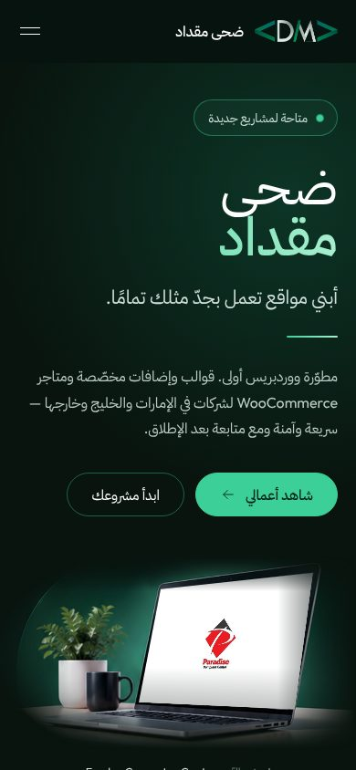

# dohamokdad.me — custom WordPress theme and core plugin

The code behind [dohamokdad.me](https://dohamokdad.me), the bilingual (English / Arabic RTL) portfolio of Doha Mokdad, Senior WordPress Developer.

It is a classic WordPress theme and a companion plugin, written from scratch. The redesigned home page (Theme 9, phase 1) runs with no page builder, no jQuery and no animation library. The inner pages are moving to the same design system next.



## What's in here

| Path | What it is |
|---|---|
| [`plugins/doha-portfolio-core`](plugins/doha-portfolio-core) | The data layer. It holds the `project` post type, its taxonomies and meta, and one counting function that every page reads its numbers from. It also has a REST endpoint and a dynamic Gutenberg block. |
| [`themes/doha-portfolio-9`](themes/doha-portfolio-9) | The presentation layer. Templates, a mobile-first CSS design system, and a small vanilla-JS file. |

The content model lives in the plugin, not the theme, so projects and their data survive any redesign. The theme checks for the plugin and backs off its own registration when the plugin is active, so either can be updated alone.

## Plugin: Doha Portfolio Core

- **Content model:** the `project` post type, plus the `project_type` and `project_company` taxonomies. Project meta (URL, country, role, tech, challenge, solution, result) is registered with `register_post_meta`.
- **One source for numbers:** `dpc_stats()` counts published projects and distinct client countries. Years of experience come from a setting. The result is cached in a transient that is cleared on `save_post_project`, delete and trash. The site never hard-codes "186 websites" anywhere.
- **REST:** `GET /wp-json/doha-portfolio/v1/stats` is a public, read-only endpoint with a JSON schema and cache headers.
- **Project Showcase block** (`doha-portfolio/project-showcase`):
  - Built with `block.json` (apiVersion 3) and React, compiled with `@wordpress/scripts`.
  - Rendered on the server by `render.php`, so it always shows the current projects.
  - Sidebar settings: number of projects, project type (loaded from `core-data`), featured only, columns, screenshot crop, and whether to show meta.
  - The editor canvas shows the real output through `ServerSideRender`.
  - Supports block alignment, spacing, colour and typography.
  - Queries are cached and keyed to the posts `last_changed` cache, so they invalidate themselves.
  - It ships an RTL stylesheet, which the build generates.



## Theme: Doha Mokdad Portfolio 9

- **Mobile first:** tested at 390, 810 and 1440 px in both languages, with no horizontal scroll.
- **Real RTL:** the CSS uses logical properties (`margin-inline`, `inset-inline-start` and so on), with `dir="rtl"` set for Arabic. Arabic gets IBM Plex Sans Arabic with its own line-height and weights. Latin text uses self-hosted Outfit, split into subsets by `unicode-range`.
- **Lean home page:**
  - One CSS file and one deferred JS file.
  - The page builder's and core block CSS are dequeued on the custom home.
  - The LCP image and font are preloaded.
- **Motion with CSS only:**
  - Entrance animations finish in a visible state, so nothing stays hidden if JS fails.
  - Scroll reveal uses `IntersectionObserver` and only affects content below the first screen.
  - `prefers-reduced-motion` is respected.
- **Laptop scene:** live project screenshots are mapped onto a laptop photo with a CSS `matrix3d` homography, solved in about 40 lines of JS. Each screenshot scrolls from the top, then the next one fades in.
- **Contact form:**
  - A nonce, a honeypot and a time trap.
  - Rate limited per IP.
  - All input sanitised and all output escaped.
  - It posts through `admin-post.php`.
- **Safe rollout:** the theme reads the previous theme's Customizer settings until it has its own, so Appearance → Themes → Live Preview shows real content before you switch.



## Develop

```bash
cd plugins/doha-portfolio-core
npm ci && npm run build      # compile the block (npm start to watch)
npm run lint:js && npm run lint:css
composer install && composer lint   # WordPress Coding Standards
```

The plugin requires WordPress 6.6+ and PHP 7.4+. The theme requires WordPress 6.0+.

CI (GitHub Actions) runs these checks on every push:
- PHP syntax on 7.4, 8.1 and 8.3.
- WPCS on the plugin.
- ESLint and Stylelint on the block.
- A check that the committed `build/` matches the source.

## Install

1. Copy `plugins/doha-portfolio-core` to `wp-content/plugins/` and activate it.
2. Copy `themes/doha-portfolio-9` to `wp-content/themes/`, then use Live Preview before you activate it.

## License

GPL-2.0-or-later. Bundled fonts and icons keep their own licences; see [LICENSE](LICENSE).
